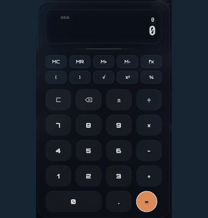
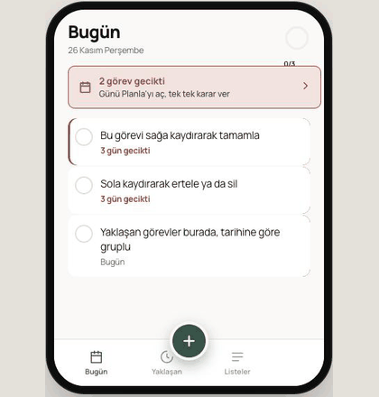
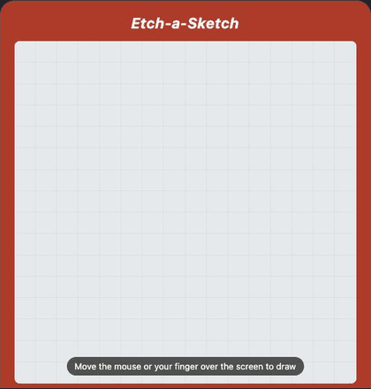
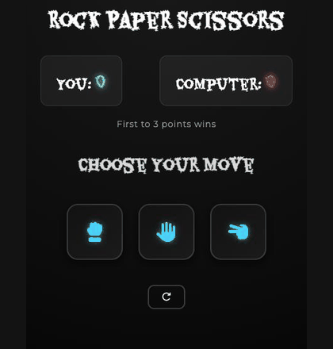

## Deniz Sevinc

Computer Science (B.Sc.) at the University of Bremen, first semester. I write Java for university and JavaScript for my own projects, mostly small web apps that keep working without a server.

Open to Werkstudent, part-time and full-time roles · Turkish (native) · German (C1) · English (B2)

### Projects

<table>
<tr>
<td width="50%" valign="top">

 <b>Ovid Calculator</b> 
Scientific calculator that keeps track of units, exact fractions and measurement error. Works offline, six languages. 
<a href="https://denizsev.github.io/ovid-calculator/">Live</a> · <a href="https://github.com/denizsev/ovid-calculator">Code</a>
</td>
<td width="50%" valign="top">

 <b>Tasks</b> 
Touch-first to-do app: no syntax, swipe gestures, data stays in the browser. 
<a href="https://denizsev.github.io/toDoAppMastering/">Live</a> · <a href="https://github.com/denizsev/toDoAppMastering">Code</a>
</td>
</tr>
<tr>
<td width="50%" valign="top">

 <b>Etch-a-Sketch</b> 
Draw on a grid with mouse or finger. 1–100 squares per side, three colour modes. 
<a href="https://denizsev.github.io/Etch-a-Sketch/">Live</a> · <a href="https://github.com/denizsev/Etch-a-Sketch">Code</a>
</td>
<td width="50%" valign="top">

 <b>Rock Paper Scissors</b> 
Play against the computer, first to 3 points wins. 
<a href="https://denizsev.github.io/rock_paper_scissors/">Live</a> · <a href="https://github.com/denizsev/rock_paper_scissors">Code</a>
</td>
</tr>
</table>

### Right now

- **Ikinci Beyin**: a study app for students (PWA, Supabase). Private beta, code not public yet.
- **University**: Programmiergrundlagen (Java), Mathematik 1, KI: Transformer der Informatik.

### Tools

